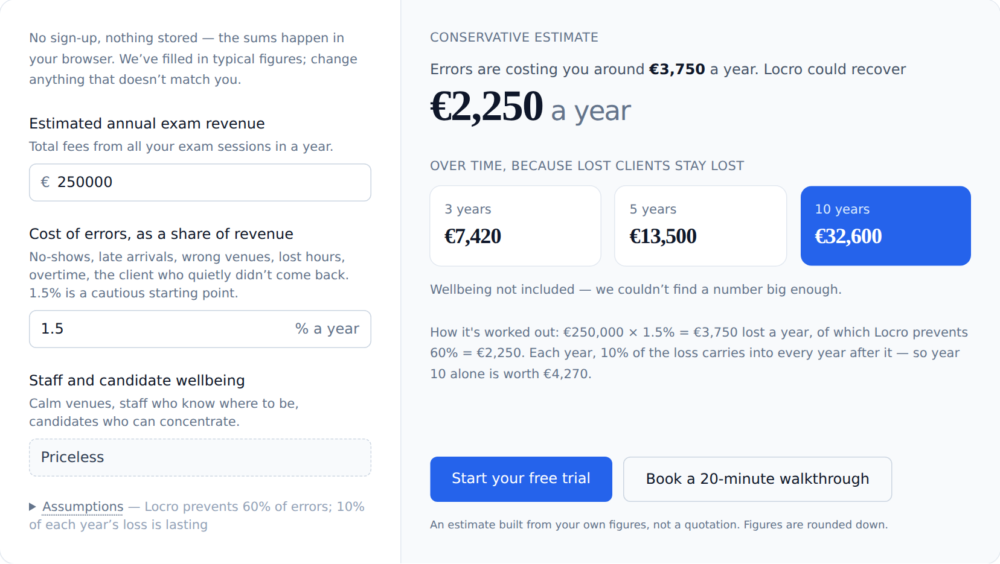

# Compound loss calculator: Locro

The ROI calculator from the landing page of [Locro](https://locro.it), a scheduling platform for
Cambridge exam centres. It answers the question every buyer asks, "what is this worth to *us*?",
using the centre's own figures, in the browser, with nothing sent or stored.



## The model

Exam centres lose money to logistics errors: staff no-shows, late arrivals, wrong venues, lost
hours. Some of that loss doesn't reset each January, because a client who leaves stays gone.

```
annual loss      = revenue × error rate
annual saving    = annual loss × share Locro prevents          (default 60%)
year k is worth  = annual saving × (1 + carry × (k − 1))       (default carry 10%)
total over n yrs = annual saving × (n + carry × n(n − 1) / 2)
```

The carry-forward is what makes the 3, 5 and 10-year figures compound. Both assumptions are
folded away under **Assumptions**, so a sceptical visitor can set either one to zero and see
what changes.

## Design decisions

- **Two inputs, not ten.** An earlier draft asked for sessions, hours and incident rates. Real
  centre managers said nobody knows their incident rate. Revenue and a pre-filled error share
  (1.5%) are figures a visitor only has to *not disagree with*.
- **Show the working.** Under the results the sum is written out in words. A number visitors can
  follow is one they'll repeat to their boss.
- **Round down, to 3 significant figures.** The estimate never looks more precise than its
  inputs, and never overstates.
- **"Staff and candidate wellbeing: Priceless."** A wink that admits the rest is an estimate.

## Run it

Open `index.html` in a browser. No build step is needed; `styles.css` is pre-compiled.

```bash
npm install && npm run css    # rebuild the Tailwind CSS after editing index.html
npm test                      # checks the compounding maths
```

Plain JavaScript (no framework) with Tailwind CSS. Built with my co-founder, who brought the
exam-centre knowledge. MIT licensed.
